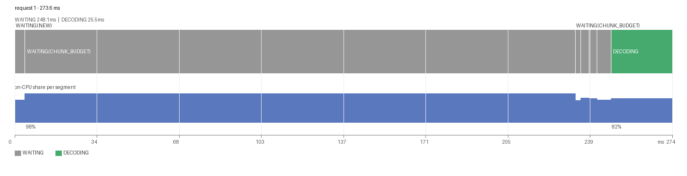
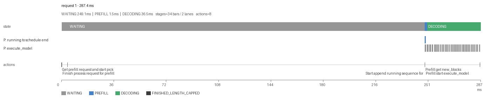
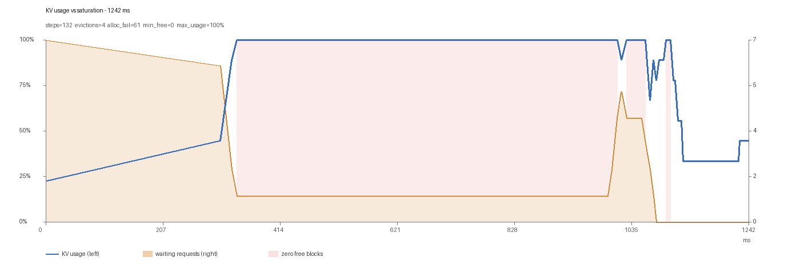
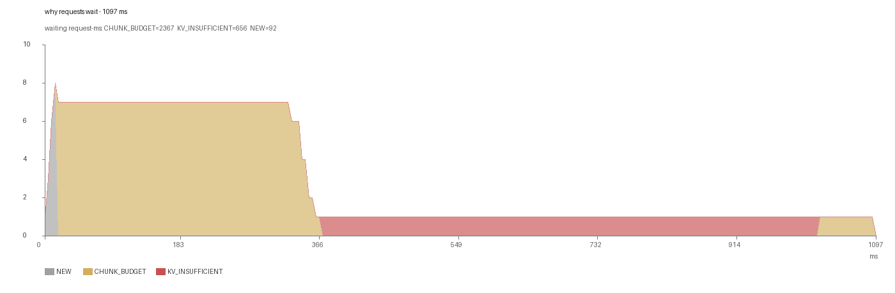
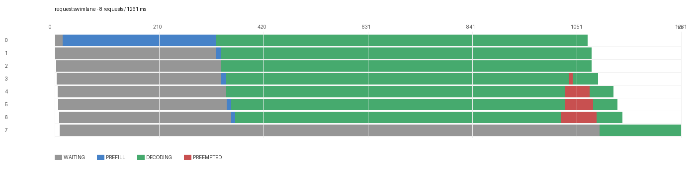
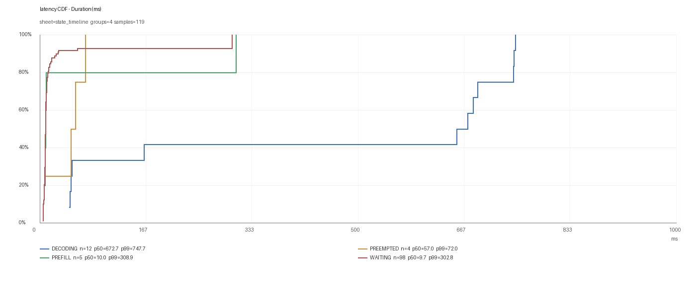
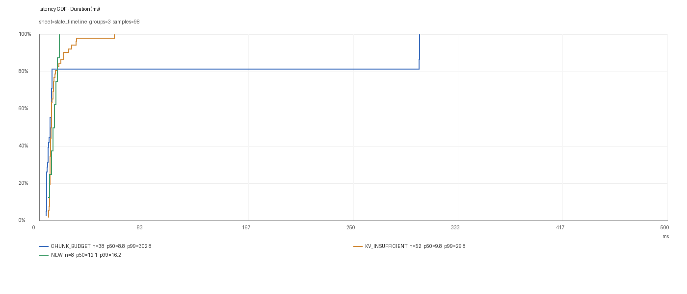

# 005 数据与展示分离

> 状态：设计已部分落地。单请求瀑布图已实现（`plot_waterfall.py`，见 §6）；
> 其余视图仍是设计。

## 1. 为什么要分离

现在 `parse_logs.py` 直接产出 `time_analysis.xlsx`：**字段、聚合、排版、颜色全耦合在一个
800 多行的脚本里**。后果：

- 加一个字段要改 parser；换个看法要重写 sheet；
- 不同问题（排队 / KV / P-D）挤在同一张 86 列的宽表里；
- 前端（如果有）只能读死字段，schema 一变就崩。

目标：**数据层只负责「完整、稳定、可查询」，展示层按问题选图，字段变了也能自适应。**

## 2. 数据层

### 2.1 三种产物

| 产物 | 格式 | 用途 |
| :-- | :-- | :-- |
| 原始事件 | JSONL（一行一事件） | 审计、重放、离线分析 |
| 规范化表 | Parquet / CSV（request / step / span 三张表） | 查询、聚合 |
| 汇总 | JSON（health + summary） | 看板、告警 |

### 2.2 schema（草案）

```text
span
  trace_id      str      请求级唯一 id
  span_id       str
  parent_id     str|None
  name          str      状态机事件名（QUEUED / PREFILL / KV_WAIT ...）
  start_ns      int      CLOCK_MONOTONIC
  end_ns        int
  on_cpu_ns     int      线程 CPU 时钟差
  status        enum     ok | missing_start | missing_end | interrupted
  attrs         map      free_blocks / running / waiting / reason ...

step
  step_id, ts, num_scheduled_tokens, num_running, num_waiting,
  free_blocks_before/after, chunk_budget, apc_hit_tokens, preempted

request
  request_id, prompt_tokens, output_tokens, role,
  queue_ms, prefill_ms, transfer_ms, decode_ms, ttft_ms, on_cpu_pct
```

**规则**：新增字段只增不改；`schema_version` 写在每个文件头；未知字段在展示层原样透传。

## 3. 展示层

### 3.1 问题 → 图表

| 问题 | 图表 | 为什么 |
| :-- | :-- | :-- |
| 这个请求慢在哪一段 | **瀑布图 / Gantt**（每请求一行，按 span 铺开） | 一眼看出等待 vs 执行 |
| 整体时间去哪了 | **堆叠条形图**（queue/prefill/transfer/decode 占比） | 总量视角 |
| 等待是不是集中在某些 step | **热图**（step × 状态时长） | 找时段/批次模式 |
| KV 是否吃紧 | **折线**（free_blocks / waiting_len 随 step 变化） | 看趋势与拐点 |
| 长尾 | **分位数曲线 / 直方图**（p50/p90/p99） | 平均值会骗人 |
| 是不是被调度走 | **on_cpu_pct 散点**（x=step，y=on_cpu%） | 区分忙等与真计算 |
| P/D 哪段慢 | **时序甘特 + 传输区间** | 跨节点对齐 |

### 3.2 视图与字段解耦

- 视图声明自己**需要哪些字段**（而不是固定列名），缺字段时降级显示而不是崩。
- 数据里字段齐全（比如 `on_cpu_ns` 即使某些 span 为 None 也要有列），
  视图按需取用。
- 颜色/分组规则放在视图配置里，不进数据。

### 3.3 交互优先级

1. 选一个请求 → 瀑布图（最常用）；
2. 选一个时间段 → 热图 + KV 折线；
3. 全局 → 分位数 + 状态占比。

## 4. 不做什么

- 不引入前端框架，先用 Python 生成静态 SVG/PNG + 一个简单的表格视图；
- 不做实时流式看板（等 metrics 模式稳定后再说）；
- 不把展示逻辑写回 `parse_logs.py`——parser 只出数据。

## 5. 待办

- [ ] 定义 `span/step/request` 三张表的列与类型（v1）。
- [ ] parser 拆成「解析 → 规范化 → 导出」三段。
- [ ] 选一个最小视图：单请求瀑布图（SVG）。
- [ ] 字段缺失/新增的兼容测试。

## 6. 已实现：单请求瀑布图（2026-11-07）

`tools/request_trace/plot_waterfall.py` 只读 `state_timeline` sheet，不解析、不聚合：

```bash
python plot_waterfall.py time_analysis.xlsx --list
python plot_waterfall.py time_analysis.xlsx --request-id 1 -o req1.png
python plot_waterfall.py time_analysis.xlsx --all --out-dir out/
```

输出三部分：

1. **状态时间轴**（上）：每个状态一段色块，等待段带 reason（如 `WAITING(CHUNK_BUDGET)`）；
2. **on-CPU 占比**（中）：每段一个高度 = on-CPU% 的柱，直接看“这段是等还是算”；
3. **标题副行**：各状态累计耗时，例如 `WAITING 248.1ms | DECODING 25.5ms`。



这张图把之前表格里 20 多行 `state_timeline` 压成一屏：一眼能看出
**248ms 里绝大部分是 `CHUNK_BUDGET` 等待，且等待期间 on-CPU 一直很高（98%）**——
即“容量饱和”，不是“卡住”。

窄段落的标签会做碰撞检测，放不下就不画（数据仍在表里），避免标签糊成一团。

### 6.1 细粒度模式（`--level detail`）

只画状态确实太粗——`stage_timings` 里有每个 step 的阶段、`time_analysis` 里有
每个动作的时间戳。detail 模式把它们一起画出来：



三轨：

1. **state**：粗粒度状态（灰=等待、绿=decode）；
2. **stages**：每个 stage 一条泳道，按 `stage_timings` 逐次绘制——图中
   `P: execute_model` 的「梳齿」就是 33 个 decode step，每个约 0.5ms；
3. **actions**：`time_analysis` 里的原始动作时间戳（到达、拿块、进 running、
   开始执行…），按标签包围盒做碰撞检测，两行交错。

```bash
python plot_waterfall.py t.xlsx --request-id 1 --level detail -o detail.png
```

局限：0.5ms 的步骤在 287ms 的横轴上只有 2px，detail 模式用「最小 2px 宽」保证可见；
要看单步内部，还需要 `--zoom`（未实现）或直接看 `stage_timings` 表。

## 7. 新增三张总览/分解图（2026-11-07）

都只读 sheet、不解析，和瀑布图共用 `plot_common.py` 的配色与字体。

### 7.1 KV 利用率 × 饱和（USE 面板）

`plot_kv_use.py`：左轴 KV usage，右轴 waiting 请求数，粉色区域 = `free_blocks == 0`。



读法：usage 爬到 100%、粉色区域出现、waiting 同时抬升 → **KV 饱和**；
usage 高但 waiting 不涨 → 只是缓存占满，还没形成排队。

### 7.2 等待原因堆叠（时序版 waiting_breakdown）

`plot_wait_stack.py`：每时刻有多少请求在等、分别因为什么。



这张图直接给出了两个阶段：前 350ms 七个请求卡在 `CHUNK_BUDGET`，
之后一个请求独自卡在 `KV_INSUFFICIENT` 直到结束。

### 7.3 多请求泳道图

`plot_swimlane.py`：一请求一行，看批次怎么拼、谁被谁挡住。



能一眼看出：8 个请求一起等、一起 prefill、一起 decode，中途 4 个被抢占（红色段）。

### 7.4 统一入口

```bash
python plot_waterfall.py  time_analysis.xlsx --request-id 0 -o wf.png
python plot_kv_use.py     time_analysis.xlsx -o kv_use.png
python plot_wait_stack.py time_analysis.xlsx -o wait_stack.png
python plot_swimlane.py   time_analysis.xlsx -o swimlane.png [--max N]
```

## 8. 延迟 CDF（2026-11-07）

`plot_cdf.py`：横轴延迟、纵轴累积比例，每组一条曲线，图例直接带 `p50 / p99`。



按状态分组时能看到形态差异：`WAITING` 的 p50 只有 9.7ms 但 p99 到 302.8ms
（一条长尾），`DECODING` 集中在 672ms 附近。**只看均值会得到"平均等待 20ms"，
把这个双峰结构完全抹掉。**

按等待原因分组，长尾归因更直接：



```text
CHUNK_BUDGET    n=38  p50=8.8   p99=302.8   ← 长尾在预算等待
KV_INSUFFICIENT n=52  p50=9.8   p99=29.8    ← 短促但频繁
NEW             n=8   p50=12.1  p99=16.2
```

用法：

```bash
python plot_cdf.py t.xlsx --sheet stage_timings --group-by Stage -o cdf.png
python plot_cdf.py t.xlsx --sheet state_timeline --group-by Reason --where State=WAITING -o wait.png
python plot_cdf.py before.xlsx after.xlsx --group-by Stage -o compare.png   # 前后对比，第二条虚线
```

注意：样本太少时曲线是阶梯状的（n<50 时 p99 基本没意义），这也是为什么
`coverage_by_request` 要先告诉你"这份 trace 完整不完整"。
