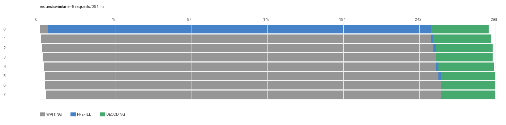
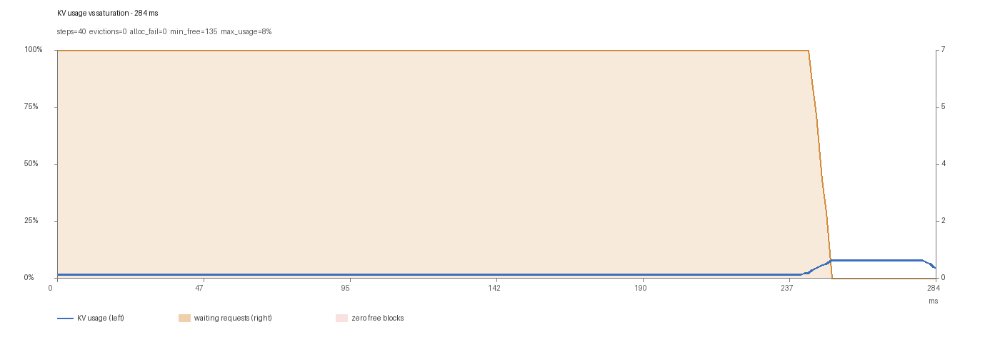
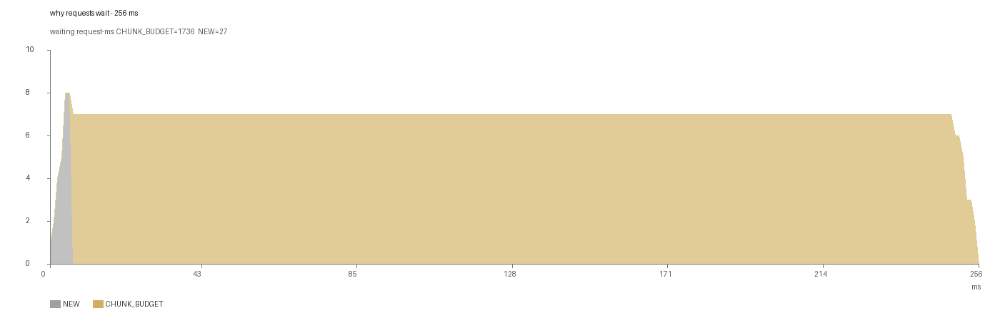

# 007 空跑全量回归：trace 功能端到端验证（2026-11-07）

> 用 `--simulate-forward` 空跑，把 **trace → 解析 → 全部 sheet → 出图** 跑一遍，
> 覆盖离线和在线两条路径。这是当前代码（mxllm `431b996`）的集成验收。

## 1. 结论

| 路径 | 结果 |
| :-- | :-- |
| 离线（`LLM` + simulate-forward） | ✅ 8 请求全部 `complete`，272 行 stage 全 ok，0 dropped |
| 在线（OpenAI server + 流式） | ✅ `ttft_ms=243.23`、`total_time_ms=245.17`，调度层打点齐全 |
| 出图 | ✅ 5 张图全部生成，数据来自同一份 xlsx |

**一个新发现**：在线路径的 `EngineCore` 是**独立子进程**，补丁必须在**导入期**应用
（不能放在 `__main__` 里），否则只有 serving 层打点，调度/KV/状态机全是空的。

## 2. 离线空跑

```bash
REQUEST_TRACE_OUTPUT_DIRECTORY=/out/trace_verify REQUEST_PD_ROLE=prefill \
  N_REQS=6 MAX_TOKENS=32 python run_e2e.py
```

- 6 个长 prompt + 2 个短请求，`max_num_batched_tokens=64` 触发 chunked prefill
- 引擎 init 6.03s / generate 0.30s

**报表**（9 个 sheet）：

```text
time_analysis / Summary / stage_timings / state_timeline / waiting_breakdown /
kv_series / kv_requests / coverage_by_request / trace_health
```

**关键数字**：

```text
actions 620        stats_logged 796      stats_dropped 0
stage rows 272     Status: ok=272        coverage 8/8 complete
state_timeline 80  kv_series 40         kv:min_free 135  max_usage 7.5%
```

## 3. 在线空跑

```bash
python run_server_traced.py --simulate-forward ... --port 8000
python online_client.py        # 流式请求，body 带 request_id
```

**结果**：

```text
RequestID            cmpl-95953438d507582e
total_time_ms        245.17
ttft_ms              243.23
actions              37      Steps 2
```

打点覆盖了 serving 层（`PD api server get request`、`First decode output token`）
和调度层（`Prefill add waiting queue`、`Prefill done execute_model`、`Sm`、`Kv`、`KvReq`）。

### 3.1 为什么第一版只有 18 条 action

第一版把 `apply_all()` 放在 `if __name__ == "__main__":` 里，结果：

```text
API server  pid=193   ← serving 层打点（18 条）
EngineCore  pid=236   ← 调度层，没有补丁，Sm/Kv 全空
```

`multiprocessing` 用 **spawn** 启动子进程，会重新 import `__main__`，
但 `__name__` 不等于 `"__main__"`，所以 `apply_all()` 不执行。

**修复**：把 `apply_all()` 移到模块导入期执行（子进程 import 时也会跑）。
之后 action 从 18 涨到 37，`Sm/Kv/KvReq` 全部出现。

> 这条也验证了补丁自身的 delayed-wrap 设计：`vllm_ascend` 的 target 在
> `EngineCoreProc.__init__` 之后才包装，必须在 engine 进程里才有意义。

### 3.2 一个诚实的 artifact

在线单节点跑的 `coverage_by_request` 是 `partial`（72.7%），原因不是丢数据：
D 侧的 stage 对（`Decode first engine token` → `Finish decode pickle`）需要真正的
decode 节点，单节点只产生了一半事件。**真 P/D 才会 100%。**

## 4. 图（同一份离线数据）



8 个请求：0 号先 prefill（蓝），其余 7 个等待（灰），之后一起 decode（绿）——
典型的「一个长 prefill 挡住整批」。





## 5. 复现

```bash
# 离线
docker exec <lab> bash -c 'REQUEST_TRACE_OUTPUT_DIRECTORY=/out/trace_verify \
  REQUEST_PD_ROLE=prefill N_REQS=6 MAX_TOKENS=32 python /out/run_e2e.py'
docker exec <lab> bash -c 'cd /mxllm/tools/request_trace && \
  python parse_logs.py /out/trace_verify'

# 在线
docker exec -d <lab> bash -c '... python /out/run_server_traced.py --simulate-forward ...'
docker exec <lab> python /out/online_client.py
```

产物：`assets/request-trace-e2e/results/verify-offline.xlsx`、`verify-online.xlsx`。

## 6. 剩余 gap

- 真机（NPU）验证：T-037 / T-038；
- 在线 P/D 双节点才能验证 100% 的 D 侧阶段；
- waiting 采样节流（T-030）——本次 8 请求没问题，100 并发需要它。
