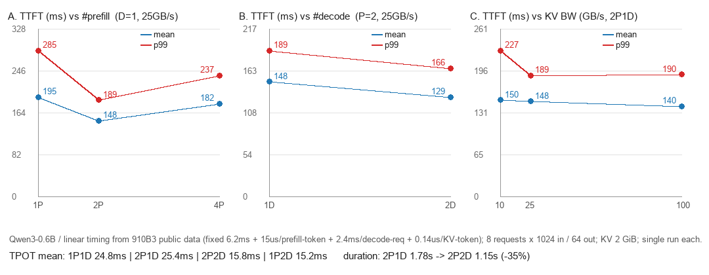

# 实验D：用 `vllm bench serve` 压 P/D 分离空跑

> 日期：2026-10-30 ｜ 基础：vLLM `a98247ab`（`sim-int:dry-run`）｜ 模型：Qwen3-0.6B
> 结论：**bench serve 可以通过一层薄代理直接压 P/D 空跑**，1P1D/2P1D/1P2D/2P2D 全部 0 失败；
> 但空跑默认 `timing=zero`（算力免费），**必须给时间模型，P/D 配比实验才有意义**。
> 标定后得到的走势与直觉一致：**加 P 在 2P 见顶，加 D 立竿见影，1K prompt 下 KV 带宽不是主变量。**

---

## 1. 问题

实验C 已经跑通了在线 P/D（两个 server + 手写两步客户端），但那是"冒烟级"的：
一个请求、没有并发、没有延迟分布。要拿到 TTFT/TPOT 分位数、goodput、可复现的 JSON，
最省事的是 `vllm bench serve`。

它能不能直接打 P/D？

**不能。** 证据：

| 证据 | 位置 |
| :-- | :-- |
| 请求结构里没有 P/D 字段 | `RequestFuncInput` 只有 prompt/len/extra_body 等 |
| benchmark 代码里 0 处 `do_remote_decode` | `grep -rn do_remote vllm/benchmarks/` 无命中 |
| `--extra-body` 是全局静态的 | 而 D 段需要**每个请求**从 P 段响应里取 `remote_block_ids` |

也就是说，缺的不是"参数"，是**两段式控制流**。

## 2. 做法：一层 180 行的代理

`pd_proxy.py` 把两段式协议包成一个 OpenAI 兼容端点：

```
client ──► proxy ──► P: max_tokens=1, stream=false, do_remote_decode=true
                     ↑ 返回 kv_transfer_params（remote_block_ids / engine_id / host / port）
             proxy ──► D: 原请求 + 该 dict，max_tokens-1，SSE 原样回传
```

关键细节：

- 代理侧**不需要**自己拼 `do_remote_prefill`：P 的返回值里已经带着（见
  `nixl/pull_scheduler.py` 的 `request_finished`），直接透传给 D 即可；
- `max_tokens - 1`：P 已经消费了一个 token，不扣会让总输出多 1；
- P 段要剥掉 `stream_options` 并强制 `stream=false`；
- round-robin 支持 `--prefill a b --decode c d`，即 XpYd。

好处是指标口径天然正确：客户端 TTFT = P 段 + KV 传输 + D 首 token，ITL/TPOT 只反映 decode
——这正是生产 P/D 的语义。bench 还会发 `stream_options.include_usage` 并采用
`usage.completion_tokens`，所以即使空跑不返回文本也能正确计数。

## 3. 用法

```bash
# 起 1P1D + 代理 + 压测 + 落盘 + 清理，一条命令
PRE=1 DEC=1 NPROMPTS=8 INLEN=1024 OUTLEN=64 ./pd/bench/pd_bench.sh

# 带时间模型
SIM_TIMING='"timing":"linear","timing_args":{"fixed_us":6200,"prefill_us_per_token":15,"decode_us_per_req":2400,"decode_us_per_kv_token":0.14}' \
  LOAD_GBPS=25 PRE=2 DEC=1 NPROMPTS=8 INLEN=1024 OUTLEN=64 ./pd/bench/pd_bench.sh
```

完整环境变量见 `pd/bench/README.md`。结果落在 `tmp/simlogs/pd_bench/*.json`。

## 4. 时间模型：默认是"免费"的

`SimulationConfig.timing` 默认 `"zero"`：每步 0 时间，只剩调度器与 KV 管理。
于是 16 请求 × 256 in / 7 out 的四组配比跑出来几乎一样：

| 配比 | TTFT mean | TPOT mean |
| :-- | -: | -: |
| 1P1D | 50.5 ms | 0.85 ms |
| 2P1D | 46.2 ms | 0.49 ms |
| 1P2D | 45.6 ms | 0.55 ms |
| 2P2D | 50.9 ms | 0.67 ms |

差异全在噪声里。**这不是"P/D 没用"，而是"算力免费时瓶颈不在算力"。**

### 4.1 可用的档位

`--simulation-config` 里的 `timing` 支持 `zero` / `linear` / `table` / `replay` / 自定义类名（`estimate(step) -> StepCost`）：

| 档位 | 参数 | 适用 |
| :-- | :-- | :-- |
| `linear` | `fixed_us` `prefill_us_per_token` `decode_us_per_req` `decode_us_per_kv_token` `host_us`/`host_fit_log` | 有硬件参数、想要可解释的趋势 |
| `table` | `path` `k` | 有录制的步日志，k-NN 插值 |
| `replay` | `path` `fallback` `miss_fallback_s` | 想逐 batch 复现录制时的耗时 |
| 自定义 | 任意 | roofline / 查表 / 自己拟合 |

真机录制走 `{"record_step_timing": true, "log_path": ...}`，但 `RecordingWorker` 用
`torch.cuda.Event` 且要求 `is_cuda_alike()`，**昇腾用不了**；昇腾要么打补丁，要么手工造 log
（格式：`{"num_reqs","num_tokens","sum_past_kv","device_s"}` 一行一条）。

### 4.2 用公开数据标定一次（不追求精确，只求量级）

| 输入 | 值 | 来源 |
| :-- | :-- | :-- |
| 910B3 BF16 峰值 / HBM | 294.91 TFLOPS / 800 GB/s | [昇腾 NPU 硬件规格](https://atomgit.com/cann/oam-tools/blob/master/skills/cann-npu-perfanalysis/references/hardware-specs.md) |
| Qwen3-0.6B TPOT @1/4/8 并发 | 8.6 / 14.7 / 25.5 ms | [ClawPerf E2E 报告](https://ucm-system.github.io/ClawPerf/E2E_TEST_REPORT/)（vllm-ascend v0.23 + 910B3） |
| Qwen3-0.6B 形状 | 28 层、8 KV head、head_dim 128、bf16 | 本地 `config.json` |

推导：

- **decode**：`TPOT ≈ a + b×并发`，拟合得 `a≈6.2 ms`、`b≈2.4 ms` →
  `fixed_us=6200`、`decode_us_per_req=2400`；
- **prefill**：0.6B 每 token ≈1.2 GFLOP，`294.91 TFLOPS × 30% MFU ÷ 1.2 GFLOP ≈ 13.6 µs` →
  取 `prefill_us_per_token=15`；
- **KV 读**：`112 KiB/token ÷ 800 GB/s ≈ 0.14 µs/token` → `decode_us_per_kv_token=0.14`；
- **传输**：`1024 token × 112 KiB = 112 MB`，10/25/100 GB/s 分别 11.2/4.5/1.1 ms。

**自洽性校验**：D=1、8 并发时模型预测每步 `6.2 + 8×2.4 + 8×1088×0.14/1000 ≈ 26.6 ms`，
实测 TPOT 24.8 ms；D=2 预测 16.4 ms，实测 15.8 ms。模型与实测对得上。

## 5. 结果：三条走势

负载：8 请求 × 1024 in / 64 out，KV 2 GiB，单次运行。



| 配置 | TTFT mean | TTFT p99 | TPOT mean | duration |
| :-- | -: | -: | -: | -: |
| 1P1D @25GB/s | 194.7 | 285.5 | 24.8 | 1.82 s |
| 2P1D @25GB/s | **148.4** | 188.7 | 25.4 | 1.78 s |
| 4P1D @25GB/s | 182.1 | 236.8 | 25.3 | 1.81 s |
| 2P1D @10GB/s | 150.1 | 227.1 | 25.2 | 1.78 s |
| 2P1D @100GB/s | 140.4 | 190.1 | 25.5 | 1.77 s |
| 1P2D @25GB/s | 163.0 | 239.0 | 15.2 | 1.19 s |
| 2P2D @25GB/s | **128.8** | 166.0 | 15.8 | **1.15 s** |

1. **加 P：1→2 有效（−24%），2→4 回退（+23%）**。2P 之后边际收益见顶——prefill 总工作量
   只有 ~120 ms。4P 的回退**存疑**：5 个 vLLM 进程挤在 8 核 Mac 容器里，真实 CPU 争抢会污染
   模拟 sleep，真机更可能是持平。
2. **加 D：立竿见影**。TPOT 25.4→15.8 ms（−38%），duration −35%。因为每步成本 ≈ `6.2 + 2.4×并发`，
   把并发摊到两台 D 上直接减半。
3. **带宽：10→100 GB/s 只值 10 ms**，与 `112 MB / 带宽` 完全吻合。1K prompt 下 KV 传输不是瓶颈；
   按同一公式，8K prompt 在 10 GB/s 下要 90 ms，那时带宽才会成为主变量。

## 6. 四个坑

1. **`timing=zero` 是默认**。不给时间模型，任何 P/D 配比结论都是噪声。
2. **KV 预算装不下工作集时，会伪装成"加 P 没用"**。第一次用 16 请求 × 2048 token、
   `KV_MB=2048`：2 GiB ÷ 112 KiB ≈ 18.7K token，而工作集 33.8K token → P 的块被 D 读完才能释放，
   两边都退化成准入排队；实测 1P1D 1040 ms、2P1D 975 ms，看起来"加 P 完全无效"。
   把工作集降到 8×1024 后趋势立刻恢复正常。**做 P/D 实验前先算一遍 token × 112 KiB。**
3. **trace 是全局一份**。bench 用 `--extra-body` 注入 `trace_decode_token_ids`，所有请求共用；
   `--random-output-len` 只起截断作用（`max_tokens=min(len(trace), max_tokens)`）。
   要每请求不同 trace，得给 `custom` 数据集补 per-request `request_overrides`。
4. **一次运行不够**。本表 duration 只有 1–2 s，±10% 以内都是噪声；正式结论要重复 3–5 次取中位数。

## 7. 结论与下一步

- bench serve + 薄代理 = 可用的 P/D 压测通道，指标口径（TTFT 含 P 段与传输、TPOT 只含 decode）正确；
- 想研究"P/D 配比"之前，先标定时间模型，并确认 KV 预算装得下工作集；
- 下一组实验建议：**prompt 长度 1K/4K/8K × 带宽 10/25/100 GB/s**，找出"带宽开始主导 TTFT"的交叉点；
  再叠加 `--request-rate` 看开放环下的排队行为。

## 8. 文件

| 路径 | 说明 |
| :-- | :-- |
| `assets/simulate-forward/pd/bench/pd_proxy.py` | 两段式 P/D 代理 |
| `assets/simulate-forward/pd/bench/pd_bench.sh` | 宿主侧一键驱动 |
| `assets/simulate-forward/pd/bench/pd_sim_launch.sh` | 容器内起 XpYd + 代理 |
| `assets/simulate-forward/pd/bench/make_pd_chart.py` | 趋势图（Pillow） |
| `assets/simulate-forward/pd/bench/pd_trend.png` | 本文的图 |

相关：实验C（仿真器与 P/D 移植）、`pd/online_pd.sh`（手写两步冒烟）。
